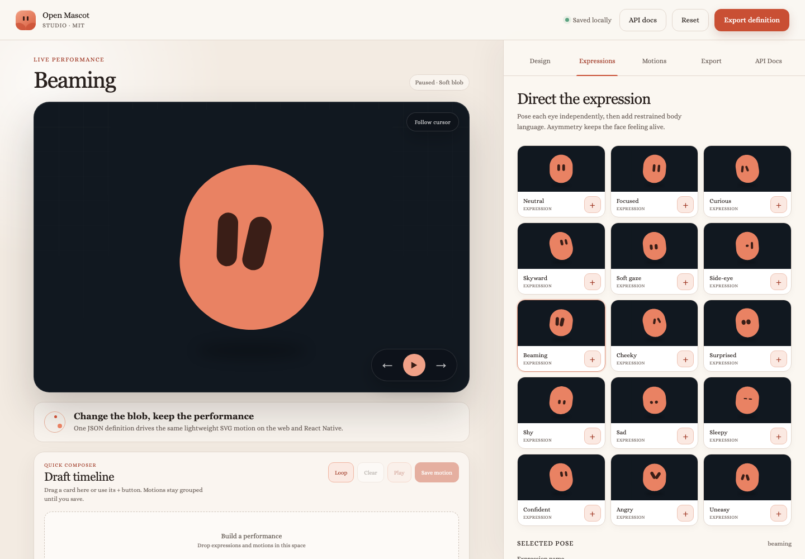
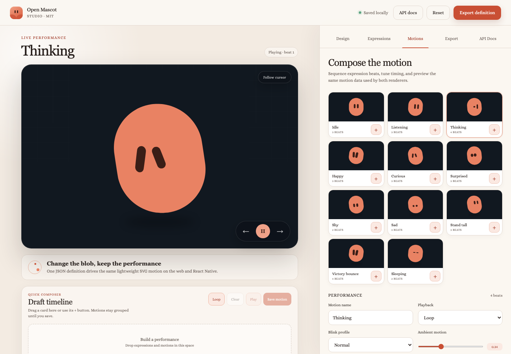
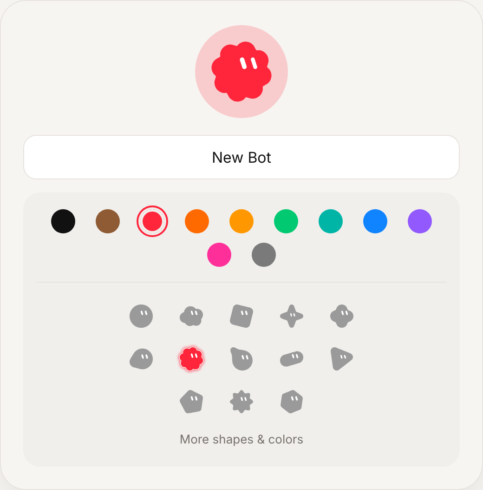
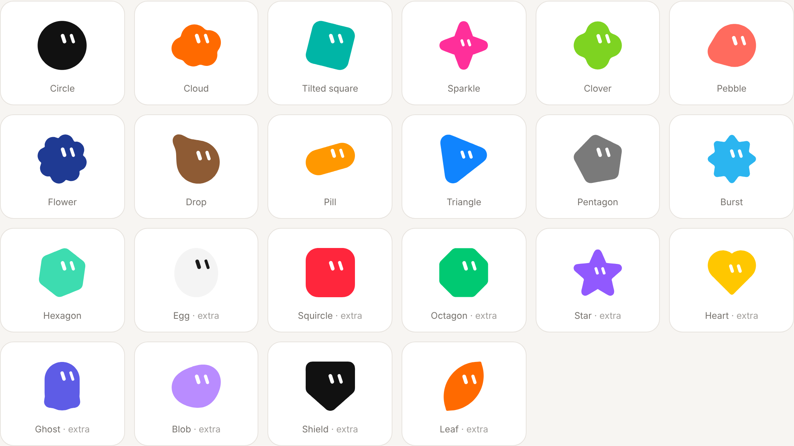
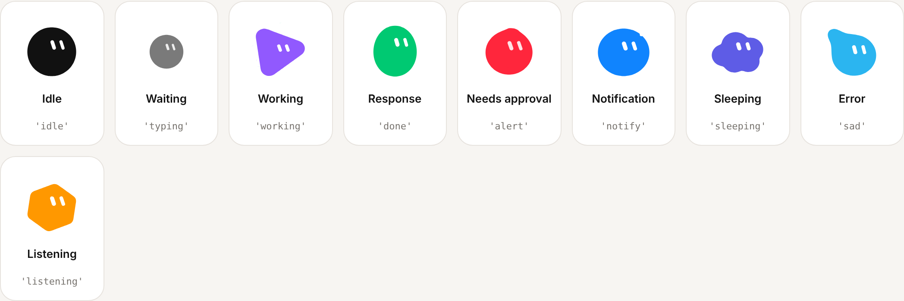

# Grok Bot — visual research gallery

This gallery preserves 12 original media files from independent MIT-licensed reference projects. These are upstream documentation images and animations, not screenshots or recordings made from the official xAI app. Original license notices are preserved. MIT does not grant rights to third-party trademarks or designs. Every destination blob SHA was compared to the upstream blob SHA during copying; visual playback was not tested.

[Machine-readable provenance](manifest.json) · [Research index](../README.md)

## open-mascot-studio

Independent generic mascot engine and editor. Upstream explicitly states that it contains no company-specific characters or private assets.

[Source at pinned revision](https://github.com/0oooh/open-mascot-studio/tree/b83ca3863f4e35424342d42538873af1bacddf9f) · [MIT notice](open-mascot-studio/LICENSE)

### Expression editor

[Upstream source](https://github.com/0oooh/open-mascot-studio/blob/b83ca3863f4e35424342d42538873af1bacddf9f/docs/assets/studio-expressions.png) · 207133 bytes · Git blob `d9e1a9443be79ffd15b940855b4102bca6eac323`

### Motion composer

[Upstream source](https://github.com/0oooh/open-mascot-studio/blob/b83ca3863f4e35424342d42538873af1bacddf9f/docs/assets/studio-motions.png) · 196885 bytes · Git blob `51276b88586b3878701da051d141b0a7cc56b3fe`

## grok-bot-characters

Independent fan recreation, not affiliated with xAI; upstream states all shapes and animations were implemented from scratch. MIT does not grant third-party design or trademark rights.

[Source at pinned revision](https://github.com/ThePeeps191/grok-bot-characters/tree/49bde09a6a2d13b08fa2ddd3a59a6fca2dc69e8e) · [MIT notice](grok-bot-characters/LICENSE)

### Character creator

[Upstream source](https://github.com/ThePeeps191/grok-bot-characters/blob/49bde09a6a2d13b08fa2ddd3a59a6fca2dc69e8e/docs/creator.png) · 56432 bytes · Git blob `9231abf5c959150b0c8eee241d6adbed0274cd10`

### Shape catalog

[Upstream source](https://github.com/ThePeeps191/grok-bot-characters/blob/49bde09a6a2d13b08fa2ddd3a59a6fca2dc69e8e/docs/shapes.png) · 129101 bytes · Git blob `ed5a6cf837b828cb5060ef84d48df8e6cef3ff89`

### State catalog

[Upstream source](https://github.com/ThePeeps191/grok-bot-characters/blob/49bde09a6a2d13b08fa2ddd3a59a6fca2dc69e8e/docs/states.png) · 61902 bytes · Git blob `42b73ff3a70262e89934890371e7fcb9db8bfc32`

## blooby

Independent mascot editor. Upstream presents these GIFs as its built-in presets rendered directly by its own renderer.

[Source at pinned revision](https://github.com/divyanshu-patil/blooby/tree/a581ed9c8bdd65bcfacf930914e96bf11ae529b0) · [MIT notice](blooby/LICENSE)

### Curved motion

[Upstream source](https://github.com/divyanshu-patil/blooby/blob/a581ed9c8bdd65bcfacf930914e96bf11ae529b0/docs/readme/preset-curved.gif) · 11971 bytes · Git blob `157dae88471299dc5cc757c4b0e92def7ec2fc47`

### Dance

[Upstream source](https://github.com/divyanshu-patil/blooby/blob/a581ed9c8bdd65bcfacf930914e96bf11ae529b0/docs/readme/preset-dance.gif) · 78223 bytes · Git blob `20cd48e6c0fc2c4427ac5ea82bd2913c4ba49f01`

### Doodle

[Upstream source](https://github.com/divyanshu-patil/blooby/blob/a581ed9c8bdd65bcfacf930914e96bf11ae529b0/docs/readme/preset-doodle.gif) · 110909 bytes · Git blob `f886f6fbdb9de57e240f505404b40b8874842174`

### Friends

[Upstream source](https://github.com/divyanshu-patil/blooby/blob/a581ed9c8bdd65bcfacf930914e96bf11ae529b0/docs/readme/preset-friends.gif) · 72158 bytes · Git blob `0647a72f9de343246c6e486949feacfd3c211836`

### Liquid motion

[Upstream source](https://github.com/divyanshu-patil/blooby/blob/a581ed9c8bdd65bcfacf930914e96bf11ae529b0/docs/readme/preset-liquid.gif) · 184259 bytes · Git blob `2fb40bf433a4979eb26b3c37e51ee1761d6d1e06`

### Full-body morph

[Upstream source](https://github.com/divyanshu-patil/blooby/blob/a581ed9c8bdd65bcfacf930914e96bf11ae529b0/docs/readme/preset-morph.gif) · 481956 bytes · Git blob `2f7336dc6b9db37d2f5d776fd57aec4f09a6d056`

### Walk cycle

[Upstream source](https://github.com/divyanshu-patil/blooby/blob/a581ed9c8bdd65bcfacf930914e96bf11ae529b0/docs/readme/preset-walk.gif) · 259943 bytes · Git blob `1feb0891fade3569ab6e431fb411cee79db350fb`

## Official product and additional visual material (external links)

No redistribution license was established for these resources. The links below are not local copies.

- [Official design case study: character and interface demonstrations](https://x.ai/news/designing-grok-bot)
- [Official design workflow and motion playground](https://x.ai/bot/guides/designing-grok-bot-with-grok-bot)
- [Grok Bot 101 workshop video](https://www.youtube.com/watch?v=8xXhE25vJZY)
- [Design workflow interview video](https://www.youtube.com/watch?v=zJEHbvT5_Yg)
- [Novra independent Rive concepts](https://www.novra.design/case-studies/grokbot)
- [60fps motion gallery](https://60fps.design/apps/grok-bot)
