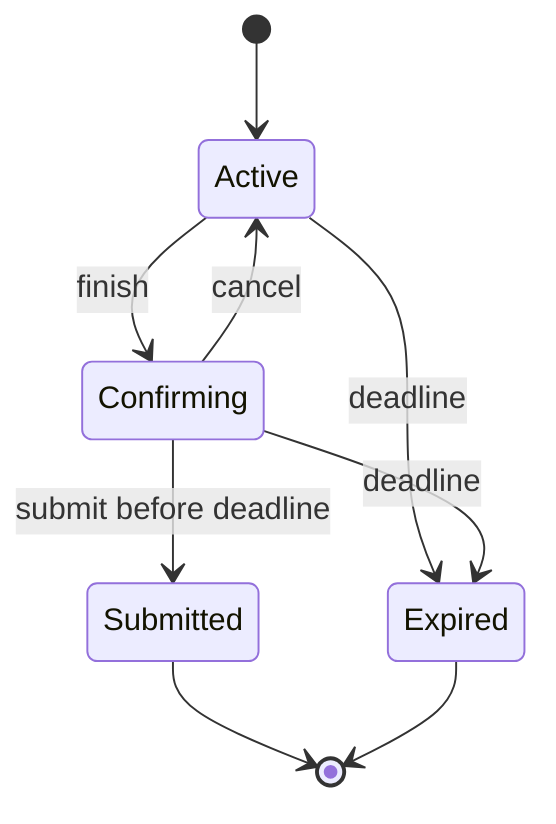

# Timed attempt state contract (#95, #105)

Original proposed reference, not a reconstruction of any third-party product. See [platform comparison](question-platform-comparison-2026-11-26.md) and [assessment model](assessment-measurement-contract-2026-11-26.md).

| From | Event | Guard | To | Feedback / focus |
|---|---|---|---|---|
| active | answer / flag / navigate | Before deadline; valid item | active | Update independent answer/flag/current states; preserve focus |
| active | finish | Before deadline | confirming | Dialog with unanswered count; focus cancel or appropriate safe control |
| confirming | cancel | Before deadline | active | Restore invoker focus |
| confirming | submit | Before deadline | submitted | Seal snapshot once; show result/pending delivery separately |
| active / confirming | tick / any event | At or after deadline | expired | Seal last accepted answers; announce expiry once |
| active | reconnect / resume | Before deadline | active | Recalculate from trusted deadline, not client countdown |
| submitted / expired | any late event | Terminal | unchanged | Ignore stale mutation; show terminal state |

The [Python reference](../../../scripts/timed_attempt_reference.py) is a pure reducer with an injected integer clock, immutable state, separate flags and response state, cancellation, no-pause deadline policy and terminal retry behavior. [Tests](../../../tests/test_timed_attempt_reference.py) exercise exact deadline, delayed reconnect, invalid events, duplicate submission, clearing answers and simultaneous flagged/answered state. A production implementation must persist the snapshot and deadline atomically, reject unauthorized callers, validate choices against the immutable item version, and expose save/delivery errors separately. This reference does not implement storage, scoring, transport, clock synchronization, keyboard/AT tests or animation. WCAG timing exceptions need assessment-specific justification and accommodations; no universal exemption for practice tests. Proposed semantic updates do not depend on motion. CI determines runtime status.
