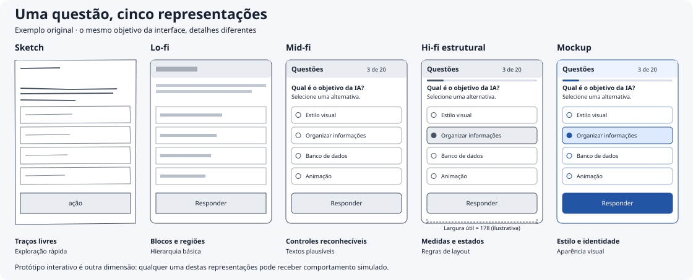
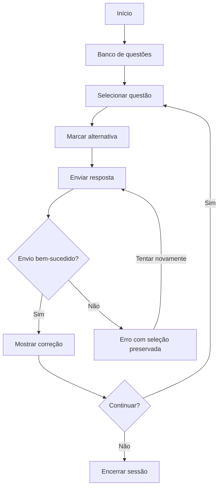

# Dez atividades iterativas de design UI/UX — guia de entregáveis e referências

Revisão documental: 2026-11-25. Síntese em português. Não é uma metodologia normativa nem avaliação de um produto real. Exemplos fictícios de um aplicativo de estudo de questões. O objetivo é selecionar o artefato mínimo para responder a uma pergunta de design; não completar dez caixas por obrigação. Design Council (Double Diamond), GOV.UK (discovery/alpha) e Houde & Hill (1997) sustentam iterar e testar conforme risco e propósito.

## Matriz

| Atividade | Pergunta | Entregável típico |
|---|---|---|
| 01. Product Discovery | Problema e contexto | Brief de pesquisa, evidências, hipóteses e decisões de escopo |
| 02. Information Architecture | Encontrabilidade e organização | Sitemap, taxonomia, modelo de navegação e/ou Object Map |
| 03. Screen Inventory | Cobertura e escopo | Tabela de telas, superfícies e estados |
| 04. User Flow | Caminhos de tarefa | Diagrama com ações, decisões, respostas e saída |
| 05. Sketch | Explorar soluções rapidamente | Alternativas rápidas e notas de decisão |
| 06. Low-fidelity Wireframe | Estrutura e hierarquia | Wireframe block, outline ou sketchy |
| 07. Mid-fidelity Wireframe | Densidade e controles | Wireframe estruturado de detalhe intermediário |
| 08. High-fidelity Wireframe | Precisão estrutural | Wireframe de alta fidelidade estrutural (opcional) |
| 09. Mockup | Aparência pretendida | Render estático visual de alta fidelidade |
| 10. Interactive Prototype | Comportamento e experiência | Protótipo operável dentro de escopo + roteiro de teste |

## Contrato recomendado por atividade

Os itens "incluir" são mínimos recomendados conforme objetivo, não requisitos universais. "Evitar" significa não introduzir ruído ou falsa certeza, não proibição absoluta. O artefato pode ser simples, descartável, combinado ou pulado; registre por quê.

### 01 — Product Discovery

- **Pergunta:** Problema e contexto.
- **Insumos e atividades:** Problema inicial, contexto, atores, restrições, entrevistas, observação e evidência existente; síntese por temas, necessidades, objetivos mensuráveis, riscos e perguntas em aberto.
- **Entregável mínimo:** Brief de pesquisa, evidências, hipóteses e decisões de escopo.
- **Incluir:** Problemas e necessidades com indicação de fonte; distinguir evidência, hipótese e decisão; escopo e próximo experimento.
- **Evitar:** Personas inventadas como evidência, feature list sem justificativa, métricas inventadas ou visual final obrigatório.
- **Exemplo didático:** Hipótese: estudantes precisam recuperar questões erradas rapidamente; investigar como fazem hoje.
- **Critério de saída:** Problema articulado e hipóteses priorizadas; decisão de avançar, investigar ou interromper, sem declarar validação inexistente.
- **Fundamentação:** NN/g Discovery; GOV.UK Discovery; affinity map Found Coffee.

### 02 — Information Architecture

- **Pergunta:** Encontrabilidade e organização.
- **Insumos e atividades:** Necessidades e conteúdos; inventariar objetos, agrupar, nomear destinos, relações, navegação global/local e busca; card sort gera opções e tree test avalia.
- **Entregável mínimo:** Sitemap, taxonomia, modelo de navegação e/ou Object Map.
- **Incluir:** Rótulos, agrupamentos, tipos de nós, relações e escopo; explicitar categorias que não são páginas e caminhos cruzados.
- **Evitar:** Não confundir sitemap com IA inteira, ERD, XML, fluxo ou lista de botões; não impor profundidade fixa ou copiar organograma.
- **Exemplo didático:** Início / Questões (Banco, Simulados) / Revisão (Erros) / Perfil; Questão relaciona-se a Matéria e Tentativa; responder/revisar são ações.
- **Critério de saída:** Tarefas de encontrabilidade definidas; categorias, rótulos e relações compreensíveis; testar e registrar lacunas.
- **Fundamentação:** NN/g IA vs Sitemap; NN/g Card Sorting vs Tree Testing; OOUX ORCA.

### 03 — Screen Inventory

- **Pergunta:** Cobertura e escopo.
- **Insumos e atividades:** IA, casos de uso, requisitos e, quando existente, rotas/capturas; listar superfícies, propósito, atores, entradas, estados, fluxos, prioridade, dependências e revisão.
- **Entregável mínimo:** Tabela de telas, superfícies e estados.
- **Incluir:** ID estável, nome, tipo (page/panel/dialog/drawer/state), tarefa, vínculo com flow, escopo/status, estados relevantes; no redesign, fonte/rota/captura.
- **Evitar:** Não tratar cada hover como tela, cada feature como página, apenas happy path, ou inventário como mockup; distinguir planejar e auditar.
- **Exemplo didático:** S01 Início; S02 Banco; S03 Resolução (sem resposta, respondida, falha); S04 Filtros drawer; S05 Explicação panel; S06 Resultado; S07 Encerrar dialog.
- **Critério de saída:** Cada tarefa prioritária tem superfícies/estados rastreáveis; identificar lacunas, duplicatas e fora de escopo.
- **Fundamentação:** NN/g Asset Mapping; Content Inventory; Lex master table. Screen Inventory é convenção prática, não taxonomia normativa.

### 04 — User Flow

- **Pergunta:** Caminhos de tarefa.
- **Insumos e atividades:** Objetivo, ator, gatilho, pré-condições, entradas, caminho principal, alternativas, erros/cancelamento/retorno; mapear passos com IDs do inventário; revisar observando tarefas.
- **Entregável mínimo:** Diagrama com ações, decisões, respostas e saída.
- **Incluir:** Início, ação, decisão rotulada, resposta, destino, conclusão e recuperação quando relevante. Wireflow opcional quando tela dinâmica muda.
- **Evitar:** Não usar setas sem gatilho, sitemap como fluxo, backend irrelevante, nem deixar saídas mortas; não confundir jornada multicanal com tarefa.
- **Exemplo didático:** Banco → escolher questão → selecionar → responder → sucesso: correção; falha: preservar seleção e tentar novamente → próxima/encerrar.
- **Critério de saída:** Percorrer tarefa e testar caminhos de risco; cada estado necessário tem origem e destino.
- **Fundamentação:** NN/g User Journeys vs User Flows; Wireflows; Figma User Flow.

### 05 — Sketch

- **Pergunta:** Explorar soluções rapidamente.
- **Insumos e atividades:** Pergunta de design e restrições; papel/whiteboard/digital; gerar alternativas, anotar o que muda, comparar com a mesma tarefa e selecionar para teste. Crazy 8's é opcional.
- **Entregável mínimo:** Alternativas rápidas e notas de decisão.
- **Incluir:** Ideia inteligível, áreas, ação principal, relação com hipótese; alternativas quando exploratório, notas e questões abertas.
- **Evitar:** Evitar pixels precisos, styling definitivo, design system obrigatório, escolher por estética sem critério; sketch pode ser wireframe, não é categoria exclusiva.
- **Exemplo didático:** Três alternativas de resolução: sidebar + questão, split view com explicação, leitura focada.
- **Critério de saída:** Alternativas suficientemente diferentes comparadas; justificar próximo teste ou refinamento.
- **Fundamentação:** Google Design Sprint Sketch/Crazy 8's; Lara Kınay.

### 06 — Low-fidelity Wireframe

- **Pergunta:** Estrutura e hierarquia.
- **Insumos e atividades:** Partir de tarefas ou sketch; regiões, hierarquia, proporções, rótulos e ações essenciais; usar placeholders só se não interferirem no teste; testar compreensão.
- **Entregável mínimo:** Wireframe block, outline ou sketchy.
- **Incluir:** Seções, navegação, ação principal, conteúdo mínimo, estados que impactam estrutura, anotações de dúvida.
- **Evitar:** Evitar marca, decoração, sombras e tipografia final sem propósito; não exigir que seja estático ou que todos os estados sejam desenhados.
- **Exemplo didático:** Sidebar matérias, área de enunciado, quatro alternativas e ação Responder.
- **Critério de saída:** Estrutura compreensível para discutir/testar sem acabamento; documentar incertezas.
- **Fundamentação:** Balsamiq; Sky View; Smashing Magazine.

#### Greybox após Sketch — revisão 2026-11-27

**Convenção de projeto, não norma universal:** quando um Sketch manuscrito já foi aprovado e o próximo objetivo é validar a estrutura de um workspace, preferir wireframe greybox/outline regular. Sketch, wireframe manuscrito e grayscale são técnicas válidas em outros contextos. Não basta trocar a fonte ou retirar o efeito de caneta.

- Separar regiões por superfícies neutras de baixo contraste; usar blocos preenchidos para conteúdo abstrato e rótulos legíveis para navegação, ações e feedback. Manter componentes reconhecíveis: radio, botão, seleção, paginação e estados. Não criar cartões, bordas ou separadores por padrão.
- Usar geometria nativa de retângulo/shape e texto editável quando disponível. Se o renderer suavizar traços fechados, usar quatro segmentos retos independentes ou o shape nativo validado; não representar o contorno inteiro por uma polilinha livre de poucos pontos. Não aplicar preset de Sketch ao wireframe estrutural. Verificar a API e a versão; não substituir por raster gerado quando editabilidade foi solicitada.
- Manter alinhamentos, largura útil, espaçamento interno menor que o entre grupos, estado ativo/inativo reconhecível e feedback textual; evitar texto cortado ou transbordamento, incluindo sidebar estreita e nomes longos. Placeholders não substituem informação necessária para entender a tarefa.
- Gate visual obrigatório: capturar no runtime real, conferir retângulos e botões não deformados, bordas, clipping, alinhamento, contraste e legibilidade no tamanho final e nos temas/variantes pertinentes; confirmar que elementos persistem e que cada estado corresponde à fonte. CI que valida IDs ou gera PNG não prova qualidade visual. Identificar SHA, origem e recorte. Se a captura falhar, não aprovar a etapa nem fingir que a prévia conceitual é a captura.
- Não antecipar tokens finais, branding, fidelidade de conteúdo ou interações não aprovadas. Estados exploratórios precisam de indicação de proposta; imagem estática não valida teclado, responsividade funcional ou fluxo executável.

**Evidência:** orientação de fabricantes, verificada por busca documental em 2026-11-27; critérios de geometria e gate são síntese aplicada, não exigência normativa: [Figma — How to wireframe](https://www.figma.com/blog/how-to-wireframe/), [Figma — Wireframe vs. Mockup](https://www.figma.com/resource-library/wireframe-vs-mockup/), [Balsamiq — What is a wireframe?](https://balsamiq.com/blog/what-are-wireframes/), [Balsamiq — exemplos](https://balsamiq.com/examples/). Sem redistribuição de imagens de terceiros.

### 07 — Mid-fidelity Wireframe

- **Pergunta:** Densidade e controles.
- **Insumos e atividades:** Usar conteúdo plausível e componentes reconhecíveis; revisar proporções, agrupamentos, hierarquia, controles e estados; anotar comportamento em larguras diferentes.
- **Entregável mínimo:** Wireframe estruturado de detalhe intermediário.
- **Incluir:** Rótulos realistas, controles reconhecíveis, textos de extensão plausível, espaçamentos aproximados e estados relevantes.
- **Evitar:** Evitar placeholder onde compreensão é essencial, branding como prioridade, precisão falsa, confundir mid-fi com obrigatório.
- **Exemplo didático:** Questão numerada, matérias selecionáveis, alternativas e botão Responder, filtro e painel de explicação.
- **Critério de saída:** Hierarquia, controles e densidade suficientes para a pergunta; testar com dados de exemplo e casos extremos.
- **Fundamentação:** Sketch; Balsamiq mid-fi; CMU/NASA p.52; Travel app wireframes.

### 08 — High-fidelity Wireframe

- **Pergunta:** Precisão estrutural.
- **Insumos e atividades:** Aprofundar dimensões, grid, conteúdo, regras de overflow, variantes, estados, comportamento responsivo e anotações de implementação conforme hipótese.
- **Entregável mínimo:** Wireframe de alta fidelidade estrutural (opcional).
- **Incluir:** Conteúdo representativo, medidas e relações mais precisas; explicitar fidelidade visual e funcional separadamente.
- **Evitar:** Não exigir cor, nem duplicar mockup, confundir precisão com validação, ou assumir que alta fidelidade prova interação/produção.
- **Exemplo didático:** Enunciados curtos/longos, sidebar colapsável, largura mínima, respostas de múltiplas linhas, explicação e navegação.
- **Critério de saída:** Questões de estrutura/densidade/responsividade resolvidas o suficiente ou prontas para teste.
- **Fundamentação:** Balsamiq, Sketch, Smashing: terminologia varia; Nomadly apenas referência interpretativa.

### 09 — Mockup

- **Pergunta:** Aparência pretendida.
- **Insumos e atividades:** Reutilizar sistema visual existente, aplicar tokens e componentes, tipografia, iconografia, cores, imagens, tema, densidade, estados e responsividade pertinente.
- **Entregável mínimo:** Render estático visual de alta fidelidade.
- **Incluir:** Hierarquia visual, conteúdo plausível, variantes de aparência, legibilidade e consistência; anotar decisões não finais.
- **Evitar:** Não fingir que screenshot é software, usar contraste insuficiente, ignorar estados, impor novo design system ou exigir lógica de backend.
- **Exemplo didático:** Mesma resolução de questão com paleta, estilos de botão, estado selecionado/correto/incorreto e tema.
- **Critério de saída:** Revisão visual e de legibilidade; acessibilidade funcional exige implementação/teste.
- **Fundamentação:** Figma Wireframe vs Mockup; Sketch comparativo.

### 10 — Interactive Prototype

- **Pergunta:** Comportamento e experiência.
- **Insumos e atividades:** Selecionar hipótese, tarefa e dimensões; conectar ações/estados, simular dados, incluir retorno/erro e feedback conforme risco; pilotar, observar usuários, corrigir e retestar.
- **Entregável mínimo:** Protótipo operável dentro de escopo + roteiro de teste.
- **Incluir:** Tarefas/escopo, estados, controles operáveis, feedback, caminhos simulados, reset e limites; teclado/foco e responsividade quando testáveis.
- **Evitar:** Não exigir hi-fi, todas as telas ou backend; não usar dados sensíveis reais, fingir persistência ou alegar validação sem teste.
- **Exemplo didático:** Escolher opção → Responder → feedback correto/incorreto → próxima; simular falha com seleção preservada.
- **Critério de saída:** Executar cenários no escopo; registrar evidência, limitações, achados e decisão; status criado ≠ validado.
- **Fundamentação:** NN/g Fidelity e IA-Based View; Houde & Hill; GOV.UK prototyping/testing; Balsamiq examples.

#### Gate de progressão por diferença de evidência — revisão 2026-11-27

Uma sequência com Sketch, Low-Fi, Mid-Fi e High-Fi só agrega valor quando cada passagem responde a uma pergunta ainda não resolvida. A semelhança visual entre artefatos é aceitável quando preserva uma composição aprovada; trocar traços por formas, preencher placeholders ou multiplicar estados, isoladamente, não demonstra avanço de aprendizagem. Não exigir diferenças estéticas artificiais.

Antes de iniciar ou fechar uma etapa, registrar: (1) hipótese/pergunta própria da etapa; (2) decisões herdadas e invariantes; (3) diferença de detalhe ou evidência necessária; (4) cenário e método de revisão/teste; (5) achado, decisão, limitação e próxima pergunta. Escolher o recorte mínimo; variantes adicionais devem justificar risco ou hipótese. Inventário e fluxos podem listar todos os estados sem reproduzir todas as telas em cada fidelidade. Um estudo de componente pode complementar uma tela, sem multiplicar destinos. Preservar snapshots históricos e identificar mudanças posteriores por referência, não reescrever aprovações.

Exemplo: Sketch compara regiões e caminhos; Low-Fi verifica composição, prioridade, navegação e estados que alteram a estrutura; Mid-Fi verifica conteúdo representativo, densidade, wrapping e controles em larguras diferentes; High-Fi estrutural (opcional) resolve medidas, limites de layout e especificações ainda abertas; Mockup verifica aparência pretendida; protótipo operável testa ações e transições. O mesmo workspace pode permanecer reconhecível. Se não há questão estrutural nova, High-Fi separado pode ser redundante; alterar a sequência formal de um projeto depende de aprovação. A evidência não exige interatividade em toda fidelidade, nem impõe testes apenas no fim.

Fontes consultadas em 2026-11-27: [NN/g — UX Prototypes: Low Fidelity vs. High Fidelity](https://www.nngroup.com/articles/ux-prototype-hi-lo-fidelity/) (eixos independentes); [Figma — What is wireframing?](https://www.figma.com/resource-library/what-is-wireframing/) e [How to wireframe](https://www.figma.com/blog/how-to-wireframe/) (escolha flexível de fidelidade); [IxDF — How to Create Wireframes](https://assets.interaction-design.org/literature/article/create-wireframes) (refinamento e testes precoces); [GOV.UK — Making prototypes](https://www.gov.uk/service-manual/design/making-prototypes) (método conforme pergunta); [Figma — Wireframe vs. Mockup](https://www.figma.com/resource-library/wireframe-vs-mockup/) (estrutura versus aparência). Gate é síntese operacional, não norma universal. Sem redistribuição de imagens ou dados privados.

## Diferenças importantes

IA é a atividade; sitemap é mapa de hierarquia; Object Map (ORCA) representa objetos, relações, CTAs e atributos, não um ERD. Screen inventory cataloga superfícies e estados; asset map organiza telas reais no tempo e é relacionado, não sinônimo necessário. Task flow é representação focada em tarefa; user flow pode mostrar alternativas; wireflow conecta layouts a ações e respostas, inclusive quando permanecem na mesma página. Journey map inclui contexto, canais, ações e experiência ao longo do tempo. Sketch é técnica exploratória e pode ser lo-fi; wireframe é estrutura, mockup é aparência, protótipo é modelo usado para aprender, inclusive em papel. Interactive prototype exige comportamento no escopo (não necessariamente código ou alta fidelidade visual). High-fidelity wireframe é nomenclatura variável: neste guia, significa precisão estrutural. Design system, wireflow, testes e implementação são atividades complementares, não novas obrigações ou etapas ocultas. Se houver roteiro ampliado com 14 atividades, preserve-o e faça correspondência sem impor numeração.

## Seleção por dimensão e risco

| Pergunta a testar | Visual | Conteúdo | Interação | Cobertura sugerida |
|---|---|---|---|---|
| Agrupamentos e rótulos | baixa | rótulos reais | tree test | hierarquia relevante |
| Layout, espaço e densidade | baixa/média | exemplos realistas | opcional | telas/estados críticos |
| Fluxos, feedback e recuperação | qualquer | realista no cenário | operável | uma tarefa vertical ou algumas |
| Marca, contraste e legibilidade | alta | realista | conforme objetivo | componentes/telas representativos |
| Viabilidade técnica | conforme hipótese | dados de teste | lógica necessária | recorte técnico |

NN/g distingue fidelidade visual, conteúdo e interação; cobertura é uma dimensão adicional de planejamento. A autora Kara Pernice também descreve cobertura horizontal (navegação ampla superficial), T (uma área profunda), M (várias) e semi-completa (muitas). Houde & Hill distinguem perguntas de papel do produto, experiência perceptiva e implementação, não uma escala única. Precisão estrutural, estilo e responsividade são descritivos independentes. Evite lorem ipsum se o entendimento do conteúdo for parte da tarefa. Não use cor como única pista de status.

## Checklist transversal e validação

- Identifique hipótese, público, tarefa, escopo, risco, evidência e resultado esperado; documente estado de validação separado de estado de produção.
- Estados quando aplicáveis: padrão, inicial/vazio, sem resultados, carregando, erro/retry, parcial, sucesso, seleção/desabilitado, confirmação, permissão, conteúdo extremo; a lista não implica criar cada variante de cada componente.
- Acessibilidade desde discovery: incluir pessoas com necessidades de acesso; rótulos claros, ordem significativa, alternativa para teclado, foco visível, não depender só de cor, contraste e reflow. WCAG 2.2 fornece critérios verificáveis para web; não declarar conformidade de desenho estático. Testar teclado, leitor de tela e zoom quando suportados; registrar limitações do protótipo.
- Em teste moderado, propor tarefas realistas sem revelar caminho, observar sem guiar, registrar conclusão, erros, recuperação e limitações; pilotar a simulação e retestar. Amostra e métricas dependem da pergunta; não inventar participantes/resultados.
- Handoff: IDs e links, estados, regras de interação, conteúdo, tokens e critérios funcionais/não funcionais pertinentes. Código de protótipo descartável não é produção segura.
- Ferramentas opcionais: discovery e IA (papel, FigJam/Miro, tabela, tree test); inventário (planilha, Markdown); flow (diagrama Mermaid/FigJam); sketch/lo-fi (papel, Balsamiq); mid/hi-fi e mockup (Figma, Sketch); protótipo (Figma, Axure, HTML/CSS/JS semântico). Não vincular fidelidade à ferramenta.

## Exemplo de inventário e fluxo (original, hipotético)

| ID | Superfície | Tipo | Estados pertinentes | Fluxo |
|---|---|---|---|---|
| S01 | Início | page | padrão/vazio | F01 |
| S02 | Banco de questões | page | loading/vazio/erro/filtrado | F01 |
| S03 | Resolver questão | workspace | sem resposta/selecionada/corrigida/falha | F01 |
| S04 | Filtros | drawer | padrão/aplicado | F01 |
| S05 | Explicação | panel | loading/erro/conteúdo | F01 |
| S06 | Resultado | page | padrão | F01 |
| S07 | Encerrar | dialog | confirmação/cancelar | F01 |

## Catálogo de fontes e referências visuais

Acesso via busca web em 2026-11-25. Links de páginas de origem, não cópias de imagens nem links assinados. A evidência de portfólio comprova apenas existência do exemplo, não usabilidade ou qualidade. Somente o diagrama Double Diamond tem licença CC BY 4.0 expressamente identificada nesta revisão; demais mídias: direitos não verificados, manter link-only. O SVG acima foi elaborado para este guia, não reproduz desenho de terceiros. A imagem retornada pela busca de uma página não comprova comportamento funcional. Referências de fidelidade às vezes são classificações interpretativas, não rótulos de autores.

- [Design Council — Double Diamond](https://www.designcouncil.org.uk/resources/the-double-diamond/) — Iteração e divergência/convergência; diagrama CC BY 4.0. (primary-method; link-only)
- [NN/g — Discovery: Definition](https://www.nngroup.com/articles/discovery-phase/) — Problema, resultados, evidência. (professional-guidance; link-only)
- [GOV.UK — User research in discovery](https://www.gov.uk/service-manual/user-research/user-research-in-discovery) — Necessidades, contexto, inclusão. (primary-practice-guide; link-only)
- [NN/g — Affinity Diagramming](https://www.nngroup.com/articles/affinity-diagram/) — Síntese de observações e ideias. (professional-guidance; link-only)
- [NN/g — Information Architecture vs. Sitemaps](https://www.nngroup.com/articles/information-architecture-sitemaps/) — Sitemap é parte da IA; exemplo visual. (professional-guidance; link-only)
- [NN/g — Card Sorting vs. Tree Testing](https://www.nngroup.com/articles/card-sorting-tree-testing-differences/) — Card sort generativo; tree test avaliativo. (professional-guidance; link-only)
- [OOUX — ORCA Handbook](https://ooux.com/offerings/xrayux) — Objetos, relações, ações e atributos; diagrama. (originator-method; link-only)
- [NN/g — Asset Mapping for Experience Consistency](https://www.nngroup.com/articles/asset-mapping/) — Catálogo de superfícies ao longo de jornadas. (professional-guidance; link-only)
- [NN/g — Content Inventory and Auditing 101](https://www.nngroup.com/articles/content-audits/) — Inventário descreve; auditoria avalia. Analogia, não norma de screen inventory. (professional-guidance; link-only)
- [Lex — Rebrand Design System Case Study](https://static1.squarespace.com/static/5660899ae4b0e9f4ea746494/t/6760da5cec3ab34b7be4e7c6/1734400619473/Lex-Rebrand-Design%2BSystem_Case%2BStudy-Unlocked.pdf) — Master table de telas; evidência de prática, não norma. (case-study; link-only)
- [NN/g — User Journeys vs. User Flows](https://www.nngroup.com/articles/user-journeys-vs-user-flows/) — Fluxo micro versus jornada macro. (professional-guidance; link-only)
- [NN/g — Wireflows](https://www.nngroup.com/articles/wireflows/) — Hotspots, ações, respostas e estados de telas. (professional-guidance; link-only)
- [Figma — Fluxo de usuário](https://www.figma.com/pt-br/resource-library/fluxo-de-usuario/) — Exemplos visuais de fluxos. (vendor-guide; link-only)
- [Google Design Sprint Kit — Sketch](https://designsprintkit.withgoogle.com/methodology/phase3-sketch) — Exploração e seleção de ideias; Crazy 8's. (originator-method; link-only)
- [Google Design Sprint — Voice Action Sprint Deck](https://designsprintkit.withgoogle.com/assets/tools/Voice%20Action%20Sprint%20Deck%20-%203-Day%20Template.pdf) — Exemplo visual e instruções Crazy 8's. (originator-method; link-only)
- [Balsamiq — What are wireframes?](https://balsamiq.com/blog/what-are-wireframes/) — Lo-fi e hi-fi; exemplos de imagens; termo hi-fi sobrepõe mockup. (vendor-guide; link-only)
- [Sketch — Wireframe examples](https://www.sketch.com/blog/wireframe-examples/) — Exemplos lo/mid/hi-fi, autores creditados na página. (vendor-guide; link-only)
- [Balsamiq — Diving into wireframes](https://balsamiq.com/learn/learning-tracks/rapid-wireframing/wireframes/) — Aula de mid-fi; Billy Carlson. (vendor-guide; link-only)
- [CMU HCII — NASA Final Report, 2010](https://hcii.cmu.edu/mhci/capstone/2010/nasa/files/NASA-FinalReport-Web.pdf) — p. 52: sketches e mid-fi; estudo aplicado, não regra geral. (academic-case; link-only)
- [Figma — Wireframe vs. mockup](https://www.figma.com/resource-library/wireframe-vs-mockup/) — Estrutura versus aparência. (vendor-guide; link-only)
- [Sketch — Wireframe vs mockup vs prototype](https://www.sketch.com/blog/wireframe-vs-mockup-vs-prototype/) — Comparação visual da mesma travel app; sobreposição de hi-fi e mockup. (vendor-guide; link-only)
- [Smashing Magazine — Wireframing: The Perfectionist’s Guide](https://www.smashingmagazine.com/2016/11/wireframe-perfectionist-guide/) — Variações de fidelidade; critérios descritivos não universais. (professional-editorial; link-only)
- [Houde & Hill — What do Prototypes Prototype? (1997)](https://hci.stanford.edu/courses/cs294h/2006/readings/houde-prototypes-97.pdf) — Role, look and feel, implementation; escolher por pergunta. (original-academic-chapter; link-only)
- [NN/g — UX Prototypes: Low Fidelity vs. High Fidelity](https://www.nngroup.com/articles/ux-prototype-hi-lo-fidelity/) — Fidelidade de visual, conteúdo, interação; pilotar teste. (professional-guidance; link-only)
- [NN/g — IA-Based View of Prototype Fidelity](https://www.nngroup.com/articles/ia-view-prototype/) — Cobertura horizontal, T, M, semi-completa. (professional-guidance; link-only)
- [GOV.UK — Making prototypes](https://www.gov.uk/service-manual/design/making-prototypes) — Protótipos descartáveis, papel/código, não produção. (primary-practice-guide; link-only)
- [GOV.UK — How the alpha phase works](https://www.gov.uk/service-manual/agile-delivery/how-the-alpha-phase-works) — Testar suposições de maior risco, escopo mínimo. (primary-practice-guide; link-only)
- [GOV.UK — Moderated usability testing](https://www.gov.uk/service-manual/user-research/using-moderated-usability-testing) — Observar tarefas, não apenas opiniões. (primary-practice-guide; link-only)
- [W3C — WCAG 2.2](https://www.w3.org/TR/WCAG22/) — Acessibilidade web; aparência isolada não prova conformidade. (normative-standard; link-only)
- [Chris C. Hardy — Found Coffee](https://chrischardy.com/found-coffee) — Mapa de afinidade; exemplo, não avaliação independente. (portfolio-example; link-only)
- [Humbleteam — UX audit](https://fintech.humbleteam.com/) — Board de captura de telas/fluxos; referência relacionada ao inventário, não formato canônico. (portfolio-example; link-only)
- [Anna Vlasiuk — User Flow Wireframes for Registration](https://dribbble.com/shots/17517345-User-Flow-Wireframes-for-Registration) — Wireflow de cadastro com alternativas e estados. (portfolio-example; link-only)
- [Lara Gülbüke Kınay — Phase 3 Sketch](https://gulbuke.medium.com/phase-3-sketch-65e60ea48f21) — Sketches de compras em papel. (portfolio-example; link-only)
- [Heidi Faith Lopez — Sky View](https://www.heidifaithlopez.com/portfolio/sky-view-airlines-a-travel-mobile-app) — Wireframes lo-fi de aplicativo de viagem. (portfolio-example; link-only)
- [Alexey Tretina — Travel app wireframes](https://dribbble.com/shots/4230021-Travel-app-wireframes) — Wireframes cinza detalhados, leitura mid-fi interpretativa. (portfolio-example; link-only)
- [Nomadly — UX/UI Case Study](https://www.behance.net/gallery/247763113/Nomadly-UXUI-Case-Study) — Referência monocromática com maior precisão; leitura hi-fi estrutural interpretativa. (portfolio-example; link-only)

## Registro e atualização do conhecimento

Delta: checklists por artefato, distinção do roteiro de dez atividades versus roteiros ampliados, orientação de exemplos e evidência, cobertura horizontal/T/M/semi-completa, critério de saída e validação, nova ilustração didática. Não criar novos padrões UI artificiais: é um guia de método/entregáveis. Plugin especialista: preservar referências existentes de planejamento (14 atividades) e wireframes, adicionar seção/ponte para este guia em `skills/wireframing-prototipagem/SKILL.md` e em referência de planejamento; registrar aprendizado incremental e versionar apenas se publicado. Status de plugin não confirmado nesta pesquisa; não declarar sincronizado sem leitura posterior.

### Skills com renderizadores e evidência visual — 2026-11-27

Pesquisa complementar, não instalação nem execução. A distinção de fidelidade depende da hipótese e não apenas de um preset visual. Catálogos de skills são fontes de descoberta; conferir o SKILL.md original, licença, dependências, renderer e exemplo antes de adotar.

| Fonte | Capacidade documentada | Evidência visual localizada |
|---|---|---|
| [wireframe-doc](https://github.com/JimmySadek/wireframe-doc) | Markdown/ASCII para HTML autocontido, fluxos, anotações, exemplo de seis frames | [sample.png](https://github.com/JimmySadek/wireframe-doc/blob/main/assets/sample.png), [showcase](https://github.com/JimmySadek/wireframe-doc/tree/main/examples/showcase) |
| [WireMD](https://github.com/akonan/wiremd/blob/main/skills/wireframe/SKILL.md) | Markdown estendido, renderer HTML, estilos e verificação por screenshot Playwright | [sketch](https://github.com/akonan/wiremd/blob/main/docs/screenshots/showcase-sketch-screenshot.png), [wireframe](https://github.com/akonan/wiremd/blob/main/docs/screenshots/showcase-wireframe-screenshot.png), [clean](https://github.com/akonan/wiremd/blob/main/docs/screenshots/showcase-clean-screenshot.png) |
| [Intent](https://github.com/ghaida/intent/blob/main/skills/wireframe/SKILL.md) | Fragmentos divergentes, telas estruturais completas e protótipo navegável; conteúdo real e separação da jornada/IA | Doutrina alternativa: fidelidade definida por escopo; não norma universal |
| [Claude Wireframe Skill](https://github.com/Magdoub/claude-wireframe-skill) | Abordagens B&W, tratamentos visuais, contexto e HTML interativo | [opção](https://github.com/Magdoub/claude-wireframe-skill/blob/main/examples/wireframe-option-detail.png), [anotações](https://github.com/Magdoub/claude-wireframe-skill/blob/main/examples/wireframe-annotations.png) |
| [Yhassy](https://github.com/yhassy/wireframe-skill/blob/main/SKILL.md) | JSON + HTML editável, rearranjo, undo/redo e exportação | template HTML; execução não verificada |
| [Wireframe Skills](https://github.com/jpoindexter/wireframe-skills/blob/main/skills/wireframe/SKILL.md) | Router de sete especializações, ideação, elementos, princípios, colaboração, feedback e handoff | instruções verificadas, exemplos visuais não recuperados |
| [Website to Wireframe](https://github.com/MathiasThorningBang/wireframe-skill) | Captura original + wireframe HTML + PNG + registro de versão via Playwright MCP | desktop 1440 e placeholders por padrão; não adequado para validar conteúdo/phone sem adaptação |

Referências visuais independentes: [Balsamiq — landing page progression](https://balsamiq.com/blog/designing-landing-pages/), [What are wireframes?](https://balsamiq.com/blog/what-are-wireframes/), [Bubble — Balsamiq review](https://bubble.io/blog/balsamiq-review-bubble/). Caminhos das imagens dos repositórios conferidos via árvore GitHub; download direto no ambiente falhou, portanto não se declara inspeção dos pixels ou execução. Não redistribuir imagens de terceiros. Aplicação proposta: uma fonte de layout estruturada por estágio, render real + screenshot + revisão de evidência, anotações separadas e casos representativos; não substituir os boards nativos automaticamente.

### Wireframing skills — segunda rodada de descoberta visual (2026-11-27)

Pesquisa documental e visual complementar. Não executamos nem instalamos as skills; screenshots externos são estudos de caso independentes, não resultados verificados das skills. Não redistribuir imagens sem direitos. Antes de adoção, validar origem, licença, dependências, ferramentas, permissões, render e exemplos.

| Skill original ou fonte de descoberta | Evidência documentada | Uso sugerido |
|---|---|---|
| [axross/skills — wireframe-design](https://www.skills.sh/axross/skills/wireframe-design) ([repositório](https://github.com/axross/skills)) | Breadboard de UI, fluxos e alternativas low-fi | Explorar composição e navegação, sem detalhes prematuros |
| [agentic-underground/idea-to-production — mockup](https://github.com/agentic-underground/idea-to-production/blob/main/plugins/design/skills/mockup/SKILL.md) | Wireframe SVG/greyscale; mockup HTML/CSS + captura; revisão e nova captura | Separar entregáveis e estabelecer gate visual |
| [bohewu/agents_pipeline — ui-ux-workflow](https://github.com/bohewu/agents_pipeline/blob/main/skills/ui-ux-workflow/SKILL.md) | Low-fi estrutural, mid-fi conceitual, fluxos e limites explícitos de escopo | Preservar fronteiras de etapa, não confundir preview com implementação |
| [heaptracetechnology/heaptrace-skills — wireframe](https://github.com/heaptracetechnology/heaptrace-skills/blob/main/plugins/heaptrace-designer/skills/wireframe/SKILL.md) | ASCII, Excalidraw, layout desktop anotado | Esboço rápido e anotações estruturais |
| [hermesonehq/hermes-registry — sketch](https://github.com/hermesonehq/hermes-registry/blob/main/skills/creative/sketch/SKILL.md) | Exploração visual e inspeção de captura do browser | Validar render em vez de presumir resultado do código |
| [Neilander/mobile-ui-replicator](https://github.com/Neilander/mobile-ui-replicator/blob/main/SKILL.md) | Estrutura JSON e regeneração de wireframe HTML antes do acabamento | Separar fonte de estrutura do estilo visual |
| [YuriDx/design-master](https://github.com/YuriDx/design-master) | Catálogo com exemplos HTML e presets de fidelity | Estudar exemplos existentes; não confundir preset com evidência de avanço |
| [mblode/agent-skills — ui-design](https://github.com/mblode/agent-skills/blob/main/skills/ui-design/SKILL.md) | Scaffold sem estilo, retrofit e verificação separada | Dividir responsabilidades de layout e aparência |
| [seb1n — wireframing](https://github.com/seb1n/awesome-ai-agent-skills/blob/main/design-and-ui-ux/wireframing/SKILL.md) | Três níveis: estrutura, componentes, especificação precisa | Comparar taxonomia alternativa; já catalogada como descoberta |

Referências visuais independentes, links originais (consulta 2026-11-27): [Connectify low/mid](https://www.behance.net/gallery/215329859/Connectify-UIUX-Design-for-business-card-app), [Balsamiq estilos de wireframe](https://marketplace.atlassian.com/apps/1213404/balsamiq-wireframes-for-confluence-cloud), [Pinch low/mid](https://www.behance.net/gallery/139909075/Pinch-UXUI-Case-Study), [Edaly SaaS low/mid](https://www.behance.net/gallery/168482365/Edtech-SaaS-Case-Study), [Beauty Salon mid-fi](https://www.behance.net/gallery/168047609/UXUI-Beauty-Salon-Mobile-App-with-Reward-System), [E-commerce Admin mid-fi](https://www.behance.net/gallery/171422404/E-commerce-Admin-Dashboard-UI-Case-Study), [DashStack mid-fi](https://www.behance.net/gallery/233978423/DashStack-Admin-Dashboard-UI-Design). Referências de aparência de questões (mockups, não wireframes): [Trenning](https://dribbble.com/shots/25623841-Trenning-Interactive-Course-Quiz-System-for-Learners), [Course-Based Test](https://dribbble.com/shots/19386235-Course-Based-Test-UI-Design). Não inferir interatividade das imagens nem tratar classificação dos autores como norma universal. Relevância: composição permanece reconhecível, avanço por novas perguntas/evidência, não por diferenças cosméticas artificiais.
